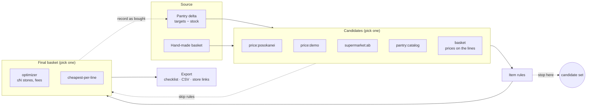

# Supermarket Manager

Weekly grocery planning for Greece. You keep a **target pantry** (which can change over time), record what is
in the house, and the app works out what is missing. Your **item rules** decide which products are acceptable, and
the app finds the **cheapest basket** across supermarkets. It runs as a desktop app with a web UI, and agents
can drive everything over **MCP**.

The modules are independent and **chainable**: any stage can be skipped or fed by hand.



| Module | What it does | Depends on |
|---|---|---|
| [`basket-core`](modules/basket-core) | Shared contracts (`Basket`, `CandidateSet`, `ResolvedBasket`), units and Greek text matching, pack filling (incl. mixing pack sizes), the `basket` source and `cheapest-per-line` resolver | — (no Spring) |
| [`pantry`](modules/pantry) | Categories (nested), concrete catalog products, **profiles with target versions over time**, stock with an event log, missing-delta → `Basket`, `pantry:catalog` source | core |
| [`item-rules`](modules/item-rules) | Deny/allow lists, unit/pack price ranges, pack-size range, own-brand, retailer allow/deny, offers-only, **mix policy** (one product / one brand / any), scoped to categories or lines | core |
| [`price-comparison`](modules/price-comparison) | PosoKanei and demo price providers (`price:*` sources), SQLite cache, retailer fees, **multi-store optimizer** | core |
| [`supermarkets`](modules/supermarkets) | Retailer adapters: **AB Vassilopoulos live search** (`supermarket:ab`), cart hand-off links, checklist/CSV export, cart SPI | core |
| [`pipeline`](modules/pipeline) | Chains the stages; saved runs; "record as bought" (once) | all of the above |
| [`mcp-server`](modules/mcp-server) | Collects every module's tools and serves them over MCP | core |
| [`app`](app) | Spring Boot app: SQLite + Flyway, REST, React UI, desktop launcher (browser + tray) | everything |
| [`frontend`](frontend) | React + Vite UI | REST API |

## Pantry: generic and concrete items

A target or stock entry refers to a **category** (`category:yoghurt`, generic, e.g. "4 × 500 g tubs of yoghurt") or a
**product** (`product:fage-…`, concrete, e.g. "2 × Fage 2% 2×200 g"). Categories nest (Dairy › Yoghurt › Strained).
**Category targets are inclusive totals**: stock of any product or sub-category below a category counts towards it,
and so do the more specific targets below it.

> Targets: yoghurt 2 kg, Fage 0.8 kg. In stock: 0.5 kg Delta strained yoghurt.
> Missing: **Fage 0.8 kg** + **any yoghurt 0.7 kg** (2 − 0.5 in stock − 0.8 already planned as Fage).

Profiles keep **versions over time**. Each version applies from its date until the next one, so a diet change can
be planned ahead. Creating a version copies the targets that are in force on its date.

## Quick start

Download the build for your OS from the GitHub releases page (see [Desktop builds](#desktop-builds)), or run from source:

```bash
mvn -pl app -am package          # builds backend + frontend, runs tests
java -jar app/target/supermarket-manager.jar
```

The app starts on <http://localhost:8765> and opens your browser. On first start, click **Load example pantry**.

| Flag / env | Effect |
|---|---|
| *(none)* | Desktop mode: open browser, tray icon with Open/Quit |
| `--server` | Server only |
| `--mcp-stdio` | MCP over stdin/stdout (no web server); shares the same database |
| `SM_PORT` | Port (default 8765) |
| `SM_DATA_DIR` | Data folder. Default: `~/Library/Application Support/SupermarketManager` (macOS), `%APPDATA%\SupermarketManager` (Windows), `~/.local/share/supermarket-manager` (Linux) |

The server only listens on 127.0.0.1 and rejects requests whose `Host` is not a loopback name (this blocks DNS rebinding).

## Chaining examples (REST)

All stages go through `POST /api/pipeline/run`. The run stops after the last stage you give.

```bash
# 1. Pantry delta only -> the basket of missing lines
curl -s localhost:8765/api/pipeline/run -H 'content-type: application/json' -d '{"source":{"type":"pantry"}}'

# 2. Full chain: pantry -> PosoKanei prices -> rule set "weekly" -> best plan over at most 2 stores -> checklist
curl -s localhost:8765/api/pipeline/run -H 'content-type: application/json' -d '{
  "source": {"type": "pantry"}, "candidates": "price:posokanei",
  "rules": {"ruleSetId": "weekly"}, "resolve": {"resolver": "optimizer", "maxRetailers": 2}, "export": true}'

# 3. A hand-made basket through the rules only (no pantry, no price lookup)
curl -s localhost:8765/api/pipeline/run -H 'content-type: application/json' -d '{
  "source": {"type": "basket", "basket": {"lines": [
    {"id": "y", "measure": "kg", "quantity": 1, "categoryId": "yoghurt",
     "product": {"name": "Fage Total 2%", "brand": "Fage"}, "offer": {"retailer": "ab", "price": 2.9, "packSize": 0.5}}]}},
  "rules": {"ruleSetId": "weekly"}}'

# 4. Pantry -> AB live prices -> cheapest at AB only, skipping rules and PosoKanei
curl -s localhost:8765/api/pipeline/run -H 'content-type: application/json' -d '{
  "source": {"type": "pantry"}, "candidates": "supermarket:ab", "resolve": {"resolver": "cheapest-per-line"}}'

# 5. After shopping: record a saved run as bought (skip what you did not buy). Refuses a second apply.
curl -s localhost:8765/api/pipeline/runs/<runId>/apply -H 'content-type: application/json' -d '{"skip": ["category:feta"]}'
```

Each module also exposes its own endpoints, so you can run one stage at a time: `POST /api/pipeline/candidates/{source}`
(basket → candidates), `POST /api/rules/apply` (candidates → candidates), `POST /api/rules/check-basket`,
`POST /api/prices/optimize` or `POST /api/pipeline/resolve/{resolver}` (candidates → final basket), and
`POST /api/supermarkets/export?format=csv|markdown`.

## Agents (MCP)

While the app runs, MCP (Streamable HTTP) is at `http://localhost:8765/mcp`:

```bash
claude mcp add --transport http supermarket-manager http://localhost:8765/mcp
```

For clients that launch a process, use `java -jar supermarket-manager.jar --mcp-stdio`, or the installed launcher
with `--mcp-stdio`. The app exposes 25 tools: `pantry_*`, `rules_*`, `prices_*`, `supermarkets_*` and `pipeline_*`. Each
module contributes its own tools through an `AgentTools` bean. **Tools never place orders or pay.**

## Data sources: what is verified

| Source | Status |
|---|---|
| `supermarket:ab`: AB Vassilopoulos e-shop GraphQL (`POST https://www.ab.gr/api/v1/`) | **Verified live 2026-10-13.** Read-only, no login. A recorded response is covered by a contract test |
| `price:posokanei`: posokanei.gov.gr (10 chains, daily) | **Not verified.** The API returned HTTP 403 to every client from the build machine (the website did too). The contract comes from the open-source posokanei-mcp |
| `price:demo` | Synthetic, invented prices for offline demos and tests. Not real |
| `pantry:catalog` | Your own catalog, without prices |

These are unofficial APIs, so they can change or block access without notice. Requests are throttled and cached.

## Desktop builds

`packaging/jpackage.sh <type>` builds a self-contained app with a bundled Java runtime (`dmg`/`pkg` on macOS,
`msi`/`exe` on Windows, `deb`/`rpm` on Linux, or `app-image` anywhere). Pushing a tag `v*` runs
[`.github/workflows/release.yml`](.github/workflows/release.yml). It builds macOS (Apple Silicon), Windows and Linux
installers plus portable archives on GitHub-hosted runners and attaches them to a GitHub release. The builds are
unsigned: macOS needs right-click → Open (or `xattr -dr com.apple.quarantine`) and Windows SmartScreen needs "Run anyway".
Each release has `SHA256SUMS` and a build-provenance attestation per file (`gh attestation verify <file> --repo <owner>/<repo>`);
see [SECURITY.md](SECURITY.md).

## Development

```bash
mvn -pl app -am package -DskipTests -Dskip.frontend=true && java -jar app/target/supermarket-manager.jar --server
cd frontend && npm install && npm run dev     # http://localhost:5173, proxies /api to :8765
mvn verify                                    # all tests (core, modules, integration with SQLite)
```

Stack: Java 25, Spring Boot 4.1, Spring AI 2.0 (MCP server), SQLite (xerial) + Flyway, React 19 + Vite 8, TypeScript 7.
Each module owns its tables and its Flyway migrations (`db/migration/<module>`, version ranges 100/200/300/500).

## License

[MIT](LICENSE). Use it, fork it, improve it. Improvements are welcome as pull requests: see [CONTRIBUTING.md](CONTRIBUTING.md).

More: [docs/ARCHITECTURE.md](docs/ARCHITECTURE.md) · [docs/SIMILAR-PROJECTS.md](docs/SIMILAR-PROJECTS.md) ·
[docs/SUPERMARKET-ADAPTERS.md](docs/SUPERMARKET-ADAPTERS.md) · [HANDOVER.md](HANDOVER.md)
